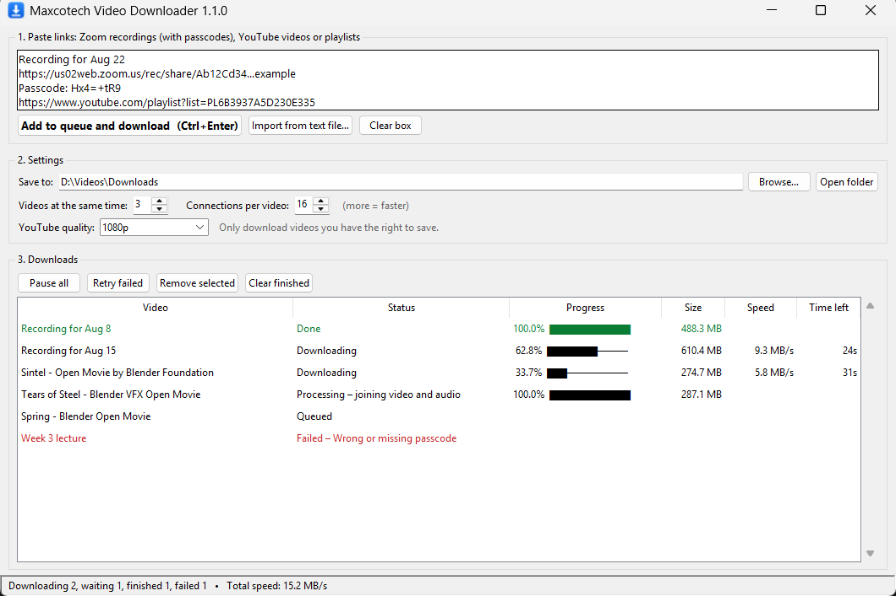

# Maxcotech Video Downloader

A Windows app for downloading **Zoom cloud recordings** (including passcode-protected
share links) and **YouTube videos and playlists** in bulk: paste a whole batch of links
at once and it downloads them in parallel, IDM-style, with pause/resume.



## Features

- **Paste anything.** Drop in whole messages: the app finds every link, the passcode next
  to each Zoom link (`Passcode:`, `Password:`, `link passcode`, `link,passcode`) and the
  title line above it, which becomes the file name.
- **Zoom recordings**, including links protected by Zoom's current passcode screen.
- **YouTube** videos, Shorts, playlists and channels, at **Best, 1080p, 720p, 480p** or
  **Audio only (MP3)**. A playlist becomes one row per video, each keeping the quality it
  was added with. At 1080p and below, H.264 + AAC MP4 is preferred so files play on any
  laptop, phone or TV.
- **Fast.** Each file is split into pieces downloaded over many connections at once
  (up to 32 for Zoom, 8 for YouTube), several videos run at the same time, and failed
  pieces retry on their own.
- **Pause and resume**, even after closing the app or losing the connection.
- **Picks your save folder** on first run; change it any time.
- **Fits any screen**: sizes itself to the display and Windows scaling (tested from
  1280×720 to 4K at 100–200%).
- **Keeps working when sites change**: the download engine ([yt-dlp](https://github.com/yt-dlp/yt-dlp))
  updates itself once a day, verified by checksum.

## Install

**[Download the latest installer](https://github.com/maxcotech/maxcotech-video-downloader/releases/latest)**
(`MaxcotechVideoDownloader-Setup-<version>.exe`, Windows 10/11 64-bit; the release notes
list its SHA-256 checksum), or build it yourself as below. It installs for the current user
without an administrator password, adds a Start menu entry (and optionally a desktop
icon), and can be removed from **Settings → Apps**. Everything it needs, including FFmpeg
and Deno, is bundled.

Windows may show **"Windows protected your PC"** because the installer isn't code-signed.
Choose **More info → Run anyway**.

## Use

1. Paste links into the top box: Zoom share links with their passcodes, YouTube video or
   playlist links, or whole messages containing them.
2. For YouTube, choose a quality under **Settings → YouTube quality**.
3. Click **Add to queue and download** (or press **Ctrl+Enter**).

Right-click a row to open the file, show it in its folder, pause, retry, copy the link,
see error details or remove it. Double-click a finished row to play it, or a failed row to
see why it failed. A longer guide is in [packaging/How to use.txt](packaging/How%20to%20use.txt).

## Responsible use

Only download videos you have the right to save: your own recordings and uploads,
Creative Commons videos, or material whose owner allows downloading. Respect your
school's or host's rules for class recordings and the terms of the sites you use.
Private, members-only and age-restricted YouTube videos aren't supported.
This project isn't affiliated with Zoom or YouTube.

## Run from source

Requires Windows and Python 3.10+.

```bash
"Start Zoom Downloader.bat"
```

The launcher creates its own Python environment on first run. YouTube downloads also need
FFmpeg and Deno: run the build once (it downloads them to `%LOCALAPPDATA%\ZBD-build\tools`,
where the app also looks), or put both on your `PATH`.

## Build the installer

Requires Python 3.10+ and [Inno Setup 6](https://jrsoftware.org/isinfo.php)
(`winget install JRSoftware.InnoSetup`).

```bash
powershell -ExecutionPolicy Bypass -File packaging\build.ps1
```

The script creates a build environment, downloads FFmpeg (LGPL shared build from
[BtbN/FFmpeg-Builds](https://github.com/BtbN/FFmpeg-Builds)) and
[Deno](https://github.com/denoland/deno) from their GitHub releases and verifies their
checksums, packages the app with PyInstaller, and writes
`dist\MaxcotechVideoDownloader-Setup-<version>.exe` (about 140 MB). Build files go to
`%LOCALAPPDATA%\ZBD-build`. Bump `APP_VERSION` in `zoom_downloader.py` for each release;
installing a newer version over an older one upgrades it in place and keeps settings.

## Tests

Run with a Python that has `yt-dlp[default]` and `requests`, for example the build
environment's `%LOCALAPPDATA%\ZBD-build\venv\Scripts\python.exe`. All tests except the
last use local test servers only.

| Test | What it checks |
|---|---|
| `tests\test_engine.py` | Link/passcode parsing, multi-connection download, cookies, retries over a flaky server, pause/resume, servers without range support |
| `tests\test_gui.py` | Paste → queue → download → done/failed through the real window |
| `tests\test_media.py` | YouTube link recognition, quality choice, joining video + audio, MP3, resume, piece-size cap |
| `tests\test_playlist_gui.py` | A playlist link becomes one row per video, each keeping its quality |
| `tests\test_layout.py` | The window fits on screens from 1280×720 to 4K at 100–200% scaling |
| `tests\test_youtube_live.py` | Optional live YouTube download (needs internet) |

```bash
python -I tests\test_engine.py zoom_downloader.py %TEMP%\zbd_test
python -I tests\test_youtube_live.py zoom_downloader.py %TEMP%\zbd_yt https://www.youtube.com/watch?v=aqz-KE-bpKQ
```

Every test takes the app file and a scratch folder as arguments, as above. The live
example uses *Big Buck Bunny* (Blender Foundation, Creative Commons Attribution).

## How it works

- **Link parsing:** `parse_links` pulls each link, its passcode and its title out of
  pasted text.
- **Opening links:** `resolve` uses yt-dlp. For Zoom, a small extractor subclass first
  submits the passcode the way Zoom's current passcode screen does
  (`/nws/recording/1.0/validate-meeting-passwd`). For YouTube, the chosen quality selects
  a video and an audio stream, and Deno runs YouTube's player challenges.
- **Downloading:** `SegmentedDownloader` fetches byte ranges in parallel over many
  connections, retries failed pieces, and records finished pieces in `<file>.part.json`
  so downloads resume. `download_target` then joins video + audio with FFmpeg (stream
  copy, no re-encoding) or converts to MP3.
- **Engine updates:** once a day the app checks PyPI for a newer yt-dlp, downloads the
  wheel (checksum verified) to `%LOCALAPPDATA%\ZoomBatchDownloader\engine`, and loads it
  ahead of the bundled copy on the next start.
- **Settings and the download list** are stored in
  `%APPDATA%\ZoomBatchDownloader\settings.json`, error details in `errors.log` next to it.
  (Folder names date from the app's first name, *Zoom Batch Downloader*, so upgrades keep
  everything.)

## Third-party software

The installer bundles [FFmpeg](https://ffmpeg.org) (LGPL v2.1+, as separate replaceable
DLLs), [Deno](https://deno.land) (MIT), [yt-dlp](https://github.com/yt-dlp/yt-dlp) and
[yt-dlp-ejs](https://github.com/yt-dlp/ejs) (Unlicense), plus Python, Tcl/Tk and Python
packages under their own licenses. Details:
[packaging/Third-party notices.txt](packaging/Third-party%20notices.txt).

## License

[MIT](LICENSE) © 2026 Maxcotech LTD. The bundled third-party components keep their own
licenses (see above).

---

Powered by **Maxcotech LTD**.
